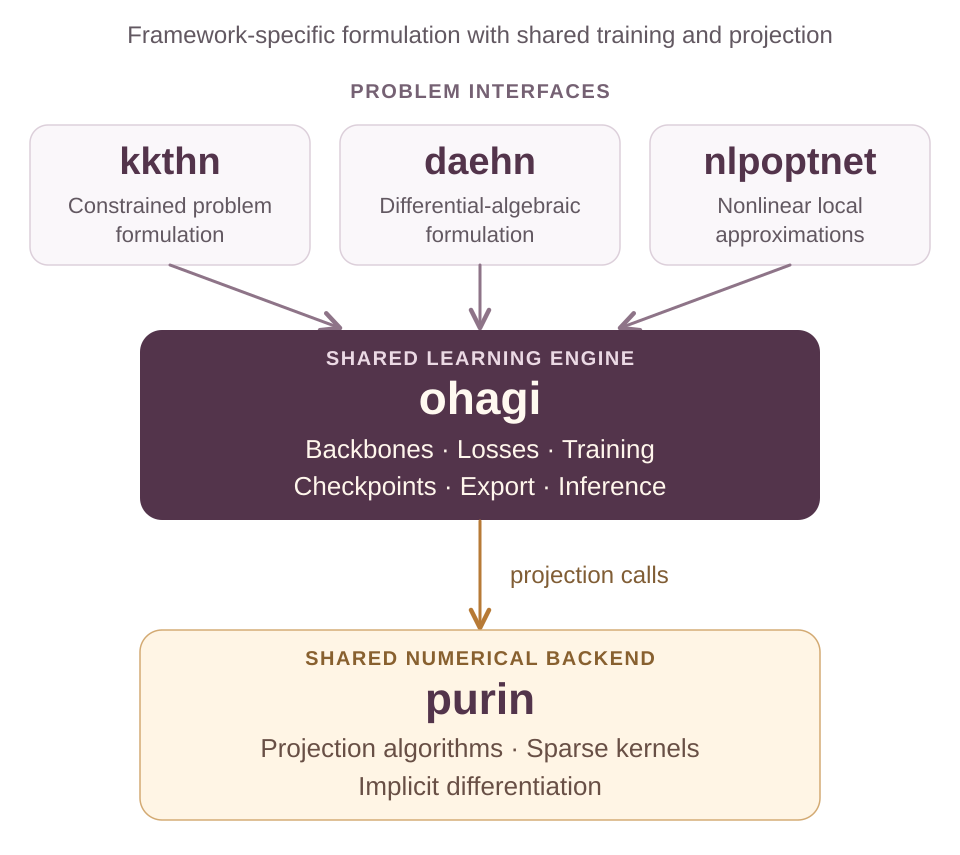

<p align="center">
  
</p>

# PURIN

**Differentiable constrained projections and sparse numerical kernels in JAX.**

PURIN turns problem definitions into reusable projection layers. Use it on
its own or as the numerical backend for OHAGI and the KKTHN, DAEHN and
NLPOPTNet frontends.

[Installation](#installation) · [Quick start](#quick-start) ·
[Projection methods](#projection-methods) · [Architecture](#architecture) ·
[Contributing](CONTRIBUTING.md)

- **Composable projections:** Euclidean distance, diagonal weighted distance
  and objective-aware local quadratic corrections.
- **Shared solvers:** closed-form equality projection, Chambolle–Pock, ADMM,
  Fischer–Burmeister variants and primal-dual interior point methods.
- **JAX integration:** sparse operators and differentiable projection layers
  for constrained learning workflows.

## Installation

Install from the GitHub source repository:

```sh
git clone https://github.com/SOULS-TAMU/Purin.git
cd Purin
python -m pip install .
```

For a local HardNet stack checkout, run `python -m pip install ./purin`
from the stack directory.

Python 3.10 or newer is required. Install JAX for your device using the
[JAX installation guide](https://docs.jax.dev/en/latest/installation.html).
PURIN does not depend on OHAGI or any frontend package.

## Quick start

Project a two-dimensional point onto the equality constraint `u + v = b`:

```python
import jax
import jax.numpy as jnp
from purin import Distance, Projection

jax.config.update("jax_enable_x64", True)

problem = Projection()
p = problem.add_parameter(["b"])
y = problem.add_variable(["u", "v"])
problem.objective = 0.0
problem.constraints.add(y.u + y.v == p.b)

project = Distance(problem, "linear-equality").prepare(batch_size=1)
candidate = jnp.array([[2.0, 0.0]])  # Shape: (batch, variables).
parameters = jnp.array([[1.0]])     # Shape: (batch, parameters).
projected = project(candidate, parameters)
print(projected)  # [[ 1.5 -0.5]]
```

Prepare the layer once and reuse it for inputs with the configured batch
size and dtype. Choose precision, solver settings and tolerances for your
problem; iterative solver convergence depends on that configuration.

## Projection methods

| Interface | Purpose |
| --- | --- |
| `Distance` | Nearest feasible point in the Euclidean metric. |
| `WeightedDistance` | Distance projection with a positive diagonal metric. |
| `LocalQuadratic` | Objective-aware local quadratic approximation. |
| `Sequential` | Composition of projection corrections. |
| `registered_methods()` | Discover available solver method names. |

Solver applicability depends on the problem structure and metric. Numerical
configuration objects control the supported iteration and gradient options.

## Architecture



PURIN owns projection problem compilation, solvers, sparse kernels and
projection differentiation. OHAGI owns the learning engine and model
deployment. The frontends supply their framework-specific formulations.

## Project information

This is the initial public source distribution. Version 0.1.0 is in
preparation; no tagged release is published yet.

[Issues](https://github.com/SOULS-TAMU/Purin/issues) ·
+[Contributing](CONTRIBUTING.md) · [Changelog](CHANGELOG.md) ·
+[BibTeX citation](CITATION.bib)

## License

PURIN is licensed under [Apache-2.0](LICENSE). Attribution is recorded in
[AUTHORS](AUTHORS) and [NOTICE](NOTICE).
